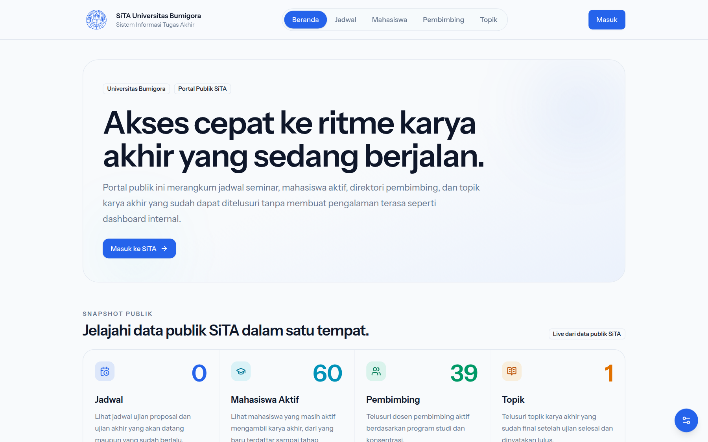
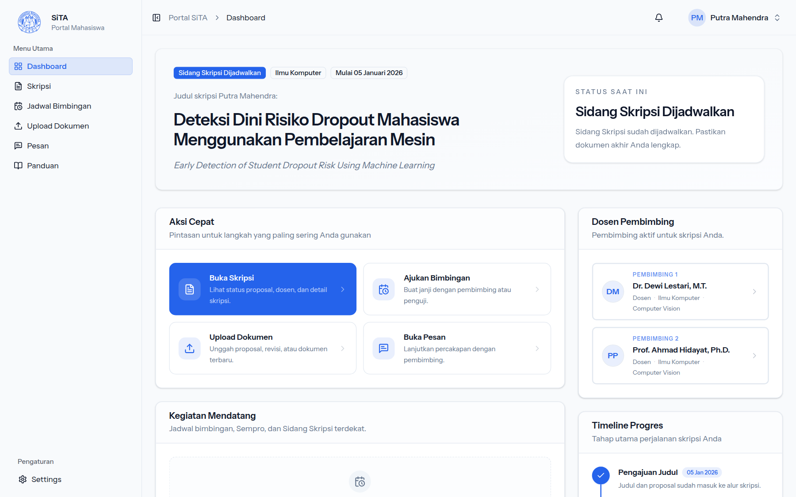
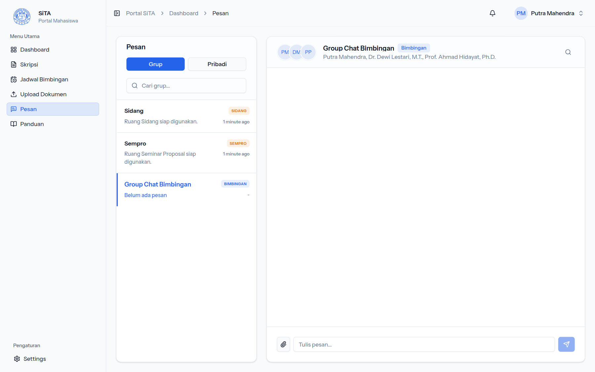
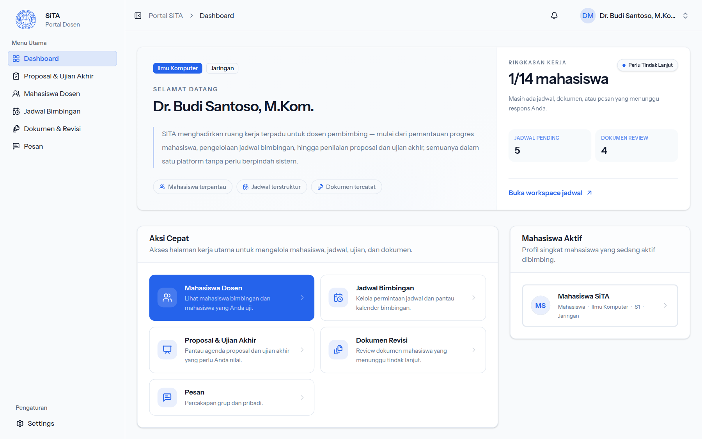
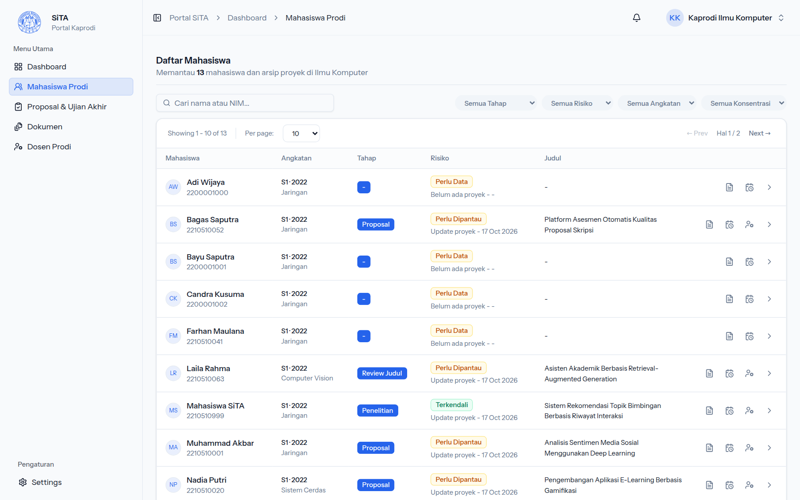
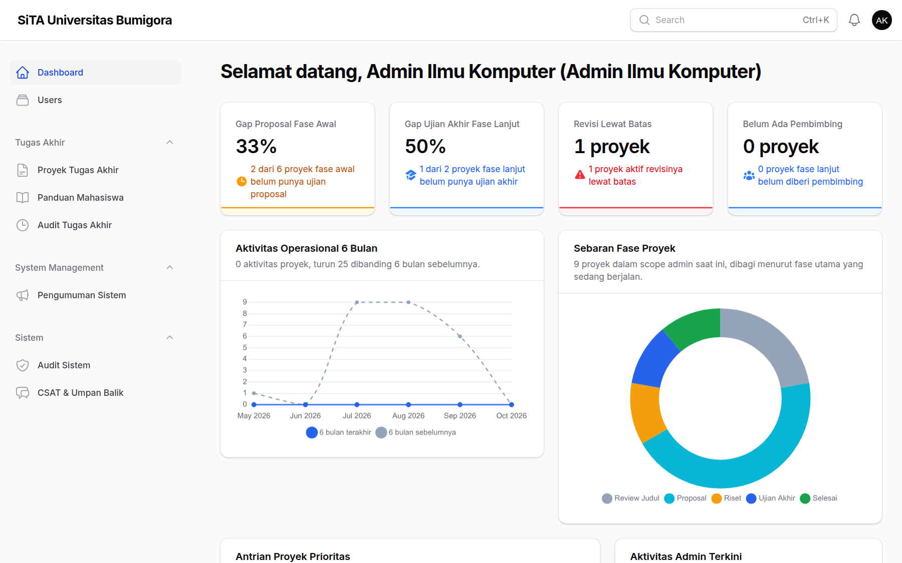

# SiTA

SiTA (Sistem Informasi Tugas Akhir) Universitas Bumigora mencatat perjalanan tugas akhir mahasiswa dari pengajuan judul sampai lulus: bimbingan, dokumen, seminar proposal, sidang, dan revisi. Mahasiswa, dosen, kaprodi, dan admin bekerja di satu aplikasi dengan chat dan notifikasi real-time.

| Portal publik                                                       | Dashboard mahasiswa                                              |
| ------------------------------------------------------------------- | ---------------------------------------------------------------- |
|                |  |
| **Chat bimbingan, sempro, dan sidang**                              | **Dashboard dosen**                                              |
|                        |          |
| **Pemantauan mahasiswa oleh kaprodi**                               | **Panel admin**                                                  |
|  |              |

Tangkapan layar memakai data contoh dari seeder.

## Fitur

| Peran     | Yang bisa dilakukan                                                                                                                                        |
| --------- | ---------------------------------------------------------------------------------------------------------------------------------------------------------- |
| Mahasiswa | Mengajukan judul dan naskah proposal, mengajukan jadwal bimbingan, mengunggah dokumen, chat dengan pembimbing/penguji, memantau sempro, sidang, dan revisi |
| Dosen     | Mengelola permintaan bimbingan, me-review dokumen, menilai ujian, memverifikasi revisi                                                                     |
| Kaprodi   | Memantau mahasiswa prodi, menetapkan pembimbing, menjadwalkan sempro dan sidang, mengatur kuota dosen                                                      |
| Admin     | Mengelola pengguna (termasuk import Excel), prodi, data tugas akhir, pengumuman, dan audit sistem lewat panel Filament                                     |

Halaman publik (`/jadwal`, `/topik`, `/pembimbing`, `/mahasiswa-aktif`) bisa dibuka tanpa login.

## Teknologi

Laravel 12 (PHP 8.4), Inertia v2 + React 19 + TypeScript, Tailwind CSS v4, Filament untuk panel admin, Laravel Reverb + Echo untuk real-time, Pest dan Playwright untuk pengujian.

## Coba cepat dengan image Docker

Cukup Docker dan Docker Compose; tidak perlu clone repo, PHP, atau Node. Image siap pakai diambil dari GHCR.

```bash
mkdir sita && cd sita
for f in docker-compose.yml docker-compose.deploy.yml .env.docker; do
  curl -fsSLO "https://raw.githubusercontent.com/RikiSanjayaa/sita/main/$f"
done
cp .env.docker .env
echo "base64:$(openssl rand -base64 32)"   # salin hasilnya ke APP_KEY di .env
```

Lalu pilih isi database:

**A. Dengan data contoh.** Set `RUN_DB_SEED=true` di `.env`, lalu jalankan:

```bash
docker compose -f docker-compose.yml -f docker-compose.deploy.yml up -d
```

Seeding pertama butuh sekitar 1-2 menit. Masuk dengan [akun contoh](#akun-contoh).

**B. Database kosong dengan super admin sendiri.** Biarkan `RUN_DB_SEED=false` (default), jalankan perintah `up` yang sama, lalu buat akun pertama secara interaktif:

```bash
docker compose -f docker-compose.yml -f docker-compose.deploy.yml exec app php artisan sita:provision-initial-super-admin
```

Masuk ke `/admin` dengan akun tersebut untuk membuat prodi, dosen, dan mahasiswa (atau import dari Excel).

Aplikasi berjalan di `http://localhost:8088`. Secara default dipakai image `main` (build terbaru); untuk versi rilis tertentu set `APP_IMAGE=ghcr.io/rikisanjayaa/sita-app:1.0.0` dan `WEB_IMAGE=ghcr.io/rikisanjayaa/sita-web:1.0.0` (atau tag `latest`). Matikan dengan `docker compose -f docker-compose.yml -f docker-compose.deploy.yml down` (tambah `-v` untuk menghapus data).

> Image GHCR dibangun untuk server produksi berbasis HTTPS, sehingga chat real-time tidak tersambung saat dicoba di `http://localhost`. Halaman tetap berfungsi; pesan baru muncul setelah halaman dimuat ulang. Untuk real-time di lokal, build image sendiri (lihat di bawah). Perbaikannya dilacak di [#42](https://github.com/RikiSanjayaa/sita/issues/42).

### Build image sendiri

Dari hasil clone repo, stack yang sama bisa di-build dari source:

```bash
cp .env.docker .env       # isi APP_KEY seperti di atas; atur RUN_DB_SEED sesuai pilihan A/B
docker compose up --build -d
```

Image hasil build lokal memakai nilai `VITE_REVERB_*` dari `.env` (default `ws://localhost:8089`), jadi chat real-time diarahkan ke Reverb lokal.

## Menjalankan untuk pengembangan

Prasyarat: PHP 8.4, Composer, Node.js 22. Database default SQLite, tidak perlu server database.

```bash
composer run setup        # install dependency, buat .env, APP_KEY, migrasi, build asset
php artisan db:seed       # opsional: akun dan data contoh
composer run dev          # server, queue, Reverb, dan Vite sekaligus
```

Buka `http://localhost:9000` (samakan `APP_URL` di `.env`). Tanpa seeder, buat akun pertama dengan `php artisan sita:provision-initial-super-admin`.

## Akun contoh

Tersedia setelah seeding; semua memakai password `password`.

| Peran                  | Email                 |
| ---------------------- | --------------------- |
| Mahasiswa              | `mahasiswa@sita.test` |
| Dosen                  | `dosen@sita.test`     |
| Kaprodi                | `kaprodi@sita.test`   |
| Admin (panel `/admin`) | `admin@sita.test`     |

## Pengujian dan kualitas kode

| Perintah                                          | Fungsi                                                                       |
| ------------------------------------------------- | ---------------------------------------------------------------------------- |
| `php artisan test --compact`                      | Test Pest (backend)                                                          |
| `npm run e2e`                                     | Test Playwright end-to-end lintas peran (`e2e:headed`, `e2e:ui` untuk debug) |
| `vendor/bin/pint --dirty`                         | Format PHP                                                                   |
| `npm run lint`, `npm run types`, `npm run format` | Lint, cek tipe, dan format frontend                                          |
| `npm run hooks:install`                           | Pasang git hook yang menjalankan test sebelum push                           |

Playwright memakai database SQLite terpisah (`database/playwright.sqlite`) yang di-reset dan di-seed otomatis, jadi data lokal tidak tersentuh. Install browser sekali dengan `npx playwright install`.

## Deployment

- **Docker**: setiap push ke `main` yang lolos test dipublikasikan sebagai image `ghcr.io/rikisanjayaa/sita-app` dan `ghcr.io/rikisanjayaa/sita-web` (tag `main` dan `sha-<commit>`; tag git `vX.Y.Z` menghasilkan `X.Y.Z` dan `latest`). Di server, `bash scripts/deploy-via-compose.sh` menarik image itu, menjalankan migrasi, me-restart service, lalu healthcheck (`HEALTHCHECK_URL` opsional). Pin versi lewat `APP_IMAGE` dan `WEB_IMAGE`. Image dibangun dengan `VITE_REVERB_APP_KEY` dari GitHub variable, jadi `REVERB_APP_KEY` di server harus sama.
- **aaPanel**: lihat [docs/AAPANEL_DEPLOYMENT.md](docs/AAPANEL_DEPLOYMENT.md).

## Troubleshooting

- **Layar kosong dengan error `You must pass your app key when you instantiate Pusher`**: isi variabel `VITE_REVERB_*` di `.env`, lalu `php artisan config:clear` dan build ulang asset (`npm run build` atau `npm run dev`).
- **Perubahan frontend tidak muncul**: jalankan `npm run dev` atau `npm run build`.
- **Chat tidak real-time**: pastikan proses Reverb berjalan (sudah termasuk di `composer run dev`).

## Berkontribusi

Pekerjaan direncanakan lewat GitHub Issues; perubahan masuk lewat pull request ke `main` dengan pesan commit [Conventional Commits](https://www.conventionalcommits.org/) (`feat:`, `fix:`, `docs:`, ...). Panduan untuk coding agent ada di [AGENTS.md](AGENTS.md).

## Rilis

Versi mengikuti [Semantic Versioning](https://semver.org/). [release-please](https://github.com/googleapis/release-please) menjaga satu PR rilis yang berisi versi berikutnya dan isi [CHANGELOG.md](CHANGELOG.md): `fix` menaikkan patch, `feat` menaikkan minor, perubahan breaking menaikkan major. Saat PR itu di-merge, tag `vX.Y.Z`, GitHub Release, dan image `X.Y.Z` serta `latest` dibuat otomatis.

## Lisensi

Dirilis di bawah [MIT License](LICENSE). Hak cipta (c) 2026 Universitas Bumigora.
